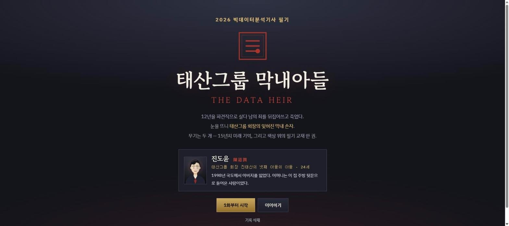
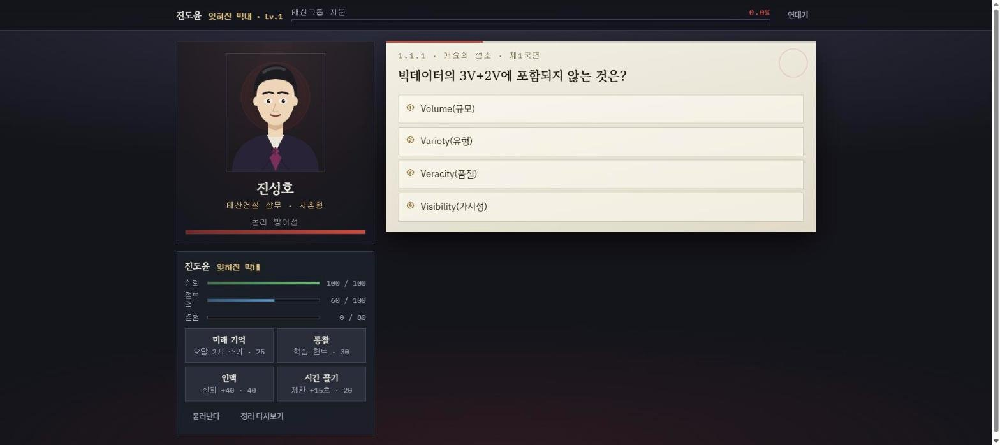

# 태산그룹 막내아들 (THE DATA HEIR)

2026 빅데이터분석기사 필기 4개 과목(21개 절, 4지선다 170문항)을 21화 분량의 대화형 이야기와 묶은 웹 학습 게임입니다. 화마다 대화 장면을 읽은 뒤 상대 인물과 '설전'(제한시간 안에 문제를 풀어 상대의 '논리 방어선'을 깎는 문제 풀이 대결)을 진행하며, 답할 때마다 정답과 해설을 보여 줍니다.

- 바로 보기: https://develop-korea-tech.github.io/bitdata/
- 형태: 단일 HTML 파일 · 설치 없음 · PC 브라우저 권장(터치로도 조작할 수 있으나 휴대폰 화면 맞춤 설정은 없음, 6절 참고)
- 기술: HTML · CSS · JavaScript(외부 라이브러리 없음) · 인물 그림은 SVG를 코드로 생성 · 글꼴은 구글 폰트
- 만든 시기: 2026-08 (마지막 업로드 기준)

| 타이틀 화면 | 설전 — 4지선다 문제와 스킬(미래 기억 · 통찰 · 인맥 · 시간 끌기) |
|---|---|
|  |  |

## 1. 주요 기능

- **이야기 진행**: 프롤로그 1편, 4막 21화, 막간 4편으로 구성됩니다. 파견직으로 일하다 죽은 주인공이 24세의 재벌 그룹 막내 손자로 깨어나, 데이터 지식으로 그룹 안의 인물들을 설득하며 지분을 모으는 줄거리입니다(타이틀 화면과 프롤로그 기준).
- **화 단위 진행**: 대화 → 방침 선택(2개 중 1개) → 미래 기억 열람(요약) → 설전 → 결과 순서로 진행합니다. 이전 화를 이겨야 다음 화가 열립니다.
- **설전(문제 풀이)**: 그 화에 연결된 절의 문제를 무작위 순서로 냅니다. 제한시간(16~22초) 안에 보기를 고르며, 맞히면 상대의 '논리 방어선'이 줄고 틀리거나 시간이 지나면 내 '신뢰'가 줄어듭니다. 방어선이 0이 되면 승리, 신뢰가 0이 되면 패배입니다. 각 막의 마지막 화(제6·12·16·21화)는 그 막에 해당하는 과목의 전체 문항에서 출제합니다.
- **해설**: 답을 고르면 정답 보기는 초록색, 고른 오답은 빨간색으로 표시되고 그 아래에 해설이 나옵니다. 틀렸을 때는 정답 번호와 내용을 함께 보여 줍니다. 170문항 모두 해설이 있습니다.
- **미래 기억 열람**: 설전 직전 화면에서 출제 범위의 핵심 정리(막의 마지막 화는 그 막의 모든 절)와 '현실 각주'(개념과 관련된 실제 사례·역사를 다룬 문장, 절마다 1개)를 보여 줍니다. 현실 각주는 결과 화면에도 다시 표시됩니다.
- **기억의 파편(오답 목록)**: 틀린 문제를 문제·정답·해설과 함께 모아 둡니다. 2개 이상 쌓이면 '회상 설전'으로 틀린 문제만 다시 풀 수 있고, 맞힌 문제는 목록에서 빠집니다.
- **핵심 정리**: 21개 절의 요약 160줄을 한 화면에서 봅니다.
- **인명록**: 대화와 설전에서 만난 인물의 그림, 역할, 관계 단계(맹우·우호·중립·경계·적대)를 보여 줍니다.
- **성장 요소**: 경험치가 쌓여 레벨이 오르면 직급(11단계)이 바뀌고 신뢰 최대치와 설득력이 커집니다. 화를 처음 이길 때마다 그 화의 보상 지분을 받으며, 21화 기본 보상의 합계는 51.0%입니다.

### 1-1. 과목별 문항 수

| 과목 | 이야기 구간 | 절 수 | 문항 수 | 핵심 정리 줄 수 |
|---|---|---:|---:|---:|
| 1과목 (절 코드 `1_x_x`) | 제1막 「말단에서 시작한다」 · 제1~6화 | 6 | 46 | 46 |
| 2과목 (`2_x_x`) | 제2막 「데이터는 거짓말을 하지 않는다」 · 제7~12화 | 6 | 43 | 45 |
| 3과목 (`3_x_x`) | 제3막 「예측하는 자가 지배한다」 · 제13~16화 | 4 | 44 | 33 |
| 4과목 (`4_x_x`) | 제4막 「왕좌」 · 제17~21화 | 5 | 37 | 36 |
| 합계 | 4막 21화 | 21 | 170 | 160 |

문항 형식은 모두 4지선다(보기 4개 중 정답 1개)입니다. 단계 순서를 묻는 문제(예: 빅데이터 처리 과정, KDD·SEMMA 절차)와 계산 문제(예: 오차행렬로 정확도 구하기, CNN 출력 크기 구하기)도 4지선다로 출제됩니다.

### 1-2. 절별 구성

★ 개수는 코드의 `star` 값(1~3)이며 요약 화면에 별로 표시됩니다. 별의 의미는 코드에 따로 적혀 있지 않습니다.

| 절 | 게임 안 이름 | ★ | 주요 내용(핵심 정리 기준) | 문항 수 |
|---|---|:-:|---|---:|
| 1.1.1 | 개요의 성소 | ★ | 데이터 유형(정형·반정형·비정형), 3V+2V, 활용 3요소, DW 특성, ETL·ODS, 조직 구성 | 8 |
| 1.1.2 | 기술의 회랑 | ★★★ | 처리 과정, 수집·저장·처리 기술(NoSQL, 맵리듀스, 하둡), 학습 방식, 비식별화, GDPR | 10 |
| 1.2.1 | 방법론의 미궁 | ★★★ | 하향식·상향식 접근, 분석 주제 유형, KDD·CRISP-DM·SEMMA, 데이터 거버넌스, 분석 성숙도 | 9 |
| 1.2.2 | 계획의 관문 | ★ | 데이터 처리·분석 영역, 데이터 확보 검토, 전처리, 품질 지표, 분석 절차 | 6 |
| 1.3.1 | 수집의 심연 | ★ | 수집 시스템 구축 절차, 스쿱·플럼·스크래피, k-익명성·l-다양성·t-근접성, 품질 기준 | 8 |
| 1.3.2 | 저장고의 파수꾼 | ★ | NoSQL 유형(key-value·column·document), 저장시스템 선정, 스트리밍 데이터, 로그 | 5 |
| 2.1.1 | 정제의 늪 | ★ | 데이터 정제, 결측 유형, 단순·다중 대치법, 이상치 탐지 | 6 |
| 2.1.2 | 변수의 대장간 | ★★ | 변수 선택, 차원 축소(차원의 저주, PCA·NMF), 파생·요약변수, 변수 변환, 불균형 처리 | 8 |
| 2.2.1 | 탐색의 서고 | ★★ | EDA, 상관분석(피어슨·스피어만), 기초 통계량(분산·왜도·첨도·IQR), 상자수염그림 | 8 |
| 2.2.2 | 시공간의 균열 | ★ | 시공간 데이터, 다변량 분석(변수축약·개체유도), 텍스트·오피니언 마이닝 | 5 |
| 2.3.1 | 확률의 제단 | ★★ | 표본추출, 조건부확률·베이즈, 이산·연속 확률분포, 표준오차, 중심극한정리 | 9 |
| 2.3.2 | 검정의 법정 | ★★ | 점추정·구간추정, 가설검정, 제1·2종 오류, p-value, 검정통계량 | 7 |
| 3.1.1 | 설계의 탑 | ★ | 분석 모형 선정 절차, 분석 유스케이스, 가설검정 절차 | 5 |
| 3.1.2 | 환경의 공방 | ★ | R·Python 비교, 학습·평가·테스트 데이터, 과대·과소적합 | 6 |
| 3.2.1 | 알고리즘의 왕좌 | ★★★ | 학습 유형별 알고리즘, 의사결정나무, 앙상블, 신경망(CNN·RNN·LSTM), SVM, 연관분석, 거리·군집분석 | 22 |
| 3.2.2 | 고급 술식의 방 | ★★ | 범주형 자료 분석(T검정·분산분석·카이제곱), 다변량 분석, 시계열(정상성·ARIMA), 비모수 검정 | 11 |
| 4.1.1 | 평가의 심판정 | ★★★ | 분류 지표(정밀도·재현율·F1·AUC), 회귀 지표, AIC, 군집 지표, 교차검증, 적합도 검정 | 12 |
| 4.1.2 | 개선의 용광로 | ★ | 규제(L1·L2), 드롭아웃, 최적화 알고리즘(SGD·모멘텀·AdaGrad·Adam), 초매개변수 | 7 |
| 4.2.1 | 해석의 거울방 | ★ | 모델별 결과 해석과 시각화 방법 | 6 |
| 4.2.2 | 시각의 화랑 | ★★ | 시각화 유형(시간·분포·관계·비교·공간), 인포그래픽 | 7 |
| 4.2.3 | 전개의 문 | ★ | 분석 방법론 비교, 전개 단계(모니터링·리모델링) | 5 |

### 1-3. 상호작용 종류

| 상호작용 | 화면 | 조작 | 처리 |
|---|---|---|---|
| 대사 넘기기 | 대화 | 대사 상자 클릭, Enter, Space | 글자가 찍히는 중이면 문장을 바로 완성하고, 다 찍혔으면 다음 대사로 넘어갑니다 |
| 방침 선택 | 대화 끝 | 선택지 2개 중 하나 클릭 | 설전의 시작 조건과 끝난 뒤의 관계 변화가 정해집니다(5-5 참고) |
| 4지선다 답하기 | 설전 | 보기 클릭 또는 숫자 키 1~4 | 채점한 뒤 해설을 표시합니다 |
| 시간 초과 | 설전 | 입력 없음 | 남은 시간이 0초가 되면 '침묵'으로 오답 처리합니다 |
| 전략 카드 | 설전 | 카드 4종 중 하나 클릭 | 정보력을 써서 보기 소거, 힌트, 신뢰 회복, 시간 연장을 합니다 |
| 회상 설전 | 기억의 파편 | **회상 설전** 버튼 | 틀린 문제만 모아 다시 출제합니다 |

## 2. 조작 방법

### 2-1. 처음 진행 순서

1. 타이틀 화면에서 **1화부터 시작**을 누릅니다. 프롤로그(대사 18줄)가 나옵니다. **이어하기**를 누르면 프롤로그 없이 연대기(화 목록)로 바로 갑니다.
2. 대사는 대사 상자를 클릭하거나 Enter·Space 키로 넘깁니다. 대사 상자 오른쪽 아래의 `▼ 클릭 / Enter` 표시가 깜박이면 다음 대사로 넘어갈 수 있습니다.
3. 프롤로그가 끝나면 **연대기** 화면이 나옵니다. 처음에는 01번 「첫 번째 시험대」만 열려 있고 나머지는 `???`로 잠겨 있습니다. 01번을 누릅니다.
4. 화 제목이 약 1.7초 표시된 뒤 대화가 이어집니다. 마지막 대사 뒤에 선택지 2개가 나오면 하나를 고릅니다. 각 선택지 아래의 작은 글씨가 그 선택의 효과입니다.
5. **미래 기억 열람** 화면에서 이번 설전 범위의 핵심 정리를 읽고 **설전 시작**을 누릅니다.
6. 설전 화면 오른쪽 문제지에서 보기를 고릅니다. 문제지 맨 위의 얇은 막대가 남은 시간이며, 6초 이하가 되면 빨간색으로 바뀝니다. 답하면 해설이 나오고, **계속**을 누르면 다음 문제로 넘어갑니다.
7. 상대의 '논리 방어선' 막대가 0이 되면 승리, 내 '신뢰' 막대가 0이 되면 패배입니다. 승리 또는 패배 대사가 나온 뒤 결과 화면이 표시됩니다.
8. 결과 화면에서 **다음 화**(이겼을 때), **다시**, **연대기**, **기억의 파편**(틀린 문제가 남아 있을 때) 중 하나를 누릅니다.

### 2-2. 입력 방법

| 구분 | 입력 | 화면 | 동작 |
|---|---|---|---|
| PC 키보드 | Enter / Space | 대화 | 대사 넘기기 |
| PC 키보드 | 1 / 2 / 3 / 4 | 설전(답하기 전) | 보기 ①~④ 선택 |
| PC 키보드 | Enter / Space | 설전(답한 뒤) | **계속** 누르기 |
| PC 마우스 | 대사 상자 클릭 | 대화 | 대사 넘기기 |
| PC 마우스 | 버튼 클릭 | 모든 화면 | 보기 선택, 카드 사용, 선택지, 메뉴 이동 |
| 모바일 터치 | 탭 | 모든 화면 | 마우스 클릭과 같습니다. 키보드 동작은 모두 화면 버튼(대사 상자, 보기, **계속**)으로 대신할 수 있습니다 |

### 2-3. 메뉴 버튼

| 버튼 | 위치 | 동작 |
|---|---|---|
| 1화부터 시작 | 타이틀 | 프롤로그를 보여 준 뒤 연대기로 이동합니다. 진행 기록은 지우지 않습니다 |
| 이어하기 | 타이틀 | 프롤로그 없이 연대기로 이동합니다 |
| 기록 삭제 | 타이틀 | 레벨·경험치·지분·완료한 화·오답 목록·정답/오답 수·관계·만난 인물·본 막간·프롤로그 시청 여부를 처음 상태로 되돌립니다 |
| 핵심 정리 / 인명록 / 기억의 파편 / 타이틀 | 연대기 오른쪽 위 | 각 화면으로 이동합니다. 기억의 파편 옆 숫자는 목록에 남아 있는 틀린 문제 수입니다 |
| 연대기 | 상단 바(타이틀을 뺀 모든 화면) | 진행 중인 대화나 설전을 멈추고 연대기로 이동합니다 |
| 물러난다 | 설전 | 설전을 그만두고 연대기로 이동합니다. 그때까지 푼 문제의 정답·오답 수와 오답 목록은 남습니다 |
| 정리 다시보기 | 설전 | 미래 기억 열람 화면으로 갑니다. 거기서 **설전 시작**을 누르면 설전이 처음부터 다시 시작됩니다 |
| 회상 설전 / 돌아가기 | 기억의 파편 | 틀린 문제로 설전을 시작합니다(2개 이상일 때만 누를 수 있음) / 연대기로 돌아갑니다 |
| 막간 버튼 | 연대기(각 막 아래) | 이미 본 막간을 다시 재생합니다 |

## 3. 실행 방법

### 3-1. 인터넷에서 바로 보기

1. 크롬이나 엣지 같은 브라우저를 엽니다.
2. 주소창에 https://develop-korea-tech.github.io/bitdata/ 를 입력해 접속합니다.
3. 타이틀 화면이 나오면 **1화부터 시작**을 누르고 2-1의 순서대로 진행합니다.
4. 진행 상황은 저장되지 않습니다. 새로고침하거나 탭을 닫으면 처음 상태로 돌아갑니다(5-7 참고).

### 3-2. 내 PC에서 실행하기

1. 저장소 페이지(https://github.com/develop-korea-tech/bitdata) 위쪽의 초록색 **Code** 버튼 → **Download ZIP**을 누릅니다.
2. 내려받은 `bitdata-main.zip` 파일을 마우스 오른쪽 버튼 → **압축 풀기**(Windows는 "모두 추출")로 풉니다.
3. 풀린 `bitdata-main` 폴더에서 `index.html`을 더블클릭합니다. 기본 브라우저에서 열립니다(크롬 권장).
   - 파일 확장자가 숨겨져 있으면 `index`로만 보입니다.
   - 메모장 등 다른 프로그램으로 열리면 파일을 마우스 오른쪽 버튼 → **연결 프로그램** → **Chrome**을 고릅니다.
4. 주의사항
   - 설치나 서버 실행이 필요 없습니다. 파일 하나로 동작하며, 외부에서 불러오는 것은 구글 폰트 글꼴뿐입니다.
   - 인터넷 연결은 글꼴(구글 폰트)에만 쓰입니다. 인터넷이 없으면 컴퓨터의 기본 글꼴(Windows는 맑은 고딕 등)로 보이고 기능은 같습니다.
   - 소리는 없습니다. 오디오를 재생하는 코드가 없습니다.
   - 진행 상황은 저장되지 않습니다. 탭을 닫거나 새로고침하면 처음부터 다시 해야 합니다.
   - 권장 화면: PC 브라우저 창 너비 960px 초과. 이때 대화·설전 화면이 좌우 2단으로 배치됩니다. 창 너비가 960px 이하이면 1단으로 바뀌고 대화 화면의 인물 그림이 작아집니다.
   - 한글이 깨진 글자로 보이면: 파일에 문자 인코딩 선언이 없어 브라우저가 인코딩을 잘못 판단한 경우입니다. 3-1의 인터넷 주소로 열거나 크롬·엣지로 다시 열어 봅니다.

## 4. 파일 구성

| 파일 | 설명 |
|---|---|
| `index.html` | 프로그램 전체(약 179KB, 2,113줄). CSS, 화면 마크업, JavaScript(문제·요약·대사 데이터와 게임 로직)가 모두 들어 있습니다 |
| `README.md` | 이 문서 |

`index.html` 내부 구성:

| 줄 | 내용 |
|---|---|
| 1~263 | `<style>`: 색 변수(`:root`), 화면별 스타일, 애니메이션(`@keyframes`), 960px 이하 1단 배치(`@media`) |
| 265~377 | 화면 마크업: 상단 바 `#bar`와 화면 9개(`<section id="s-…">`) |
| 379~2113 | `<script>`: 즉시 실행 함수 하나 |
| 387~582 | 인물 그림 데이터와 함수: `SKIN` `SKSH` `CHARS` `FACE` `HAIR`, `face()` `chr()` `portrait()` |
| 587~643 | `PHASE`(국면 전환 대사), 관계 함수, `FACT`(현실 각주) |
| 648~730 | `INTER`(막간 4편) |
| 731~996 | `Q()`, `QBANK`(문제은행), `BANK`·`findQ()`(색인) |
| 999~1180 | `SUM`(절별 핵심 정리) |
| 1183~1742 | `E()` `EB()`, `ACTS`(막 4개), `PROLOGUE`, `EPS`(21화) |
| 1745~1778 | 상태 변수(`KEY` `HERO` `P` `G` `RANKS` 등), `save()` `load()` `show()` `bar()` `seal()` |
| 1781~2080 | 화면 함수: `map()`, `play()`·`stp()`, `ep()`·`choice()`·`brief()`, `duel()`~`res()`, `frag()`·`sums()`·`who()` |
| 2085~2110 | `enter()`, 버튼·키보드 이벤트 연결, 시작할 때 `load()` 호출 |

## 5. 작동 원리

### 5-1. 전체 구조

- 스크립트 전체가 즉시 실행 함수 `(function(){ "use strict"; ... })();` 하나로 감싸져 있어 전역 변수를 만들지 않습니다.
- 화면은 `<section>` 9개와 상단 바 하나입니다. 한 번에 한 화면만 보이며, `show(id)`가 나머지 화면에 `.hide` 클래스(`display:none !important`)를 붙입니다.
- 화면 내용은 각 함수가 HTML 문자열을 만들어 `innerHTML`에 넣는 방식으로 그립니다. 새로 그린 버튼에는 그때마다 `addEventListener`로 이벤트를 연결하고, 고정 버튼(타이틀·메뉴 등)은 시작할 때 한 번 연결합니다.
- 게임 루프(`requestAnimationFrame`)는 없습니다. 클릭과 키 입력으로 함수가 호출되어 화면이 바뀌는 이벤트 방식입니다. 시간에 따라 진행되는 것은 `setInterval` 두 개뿐입니다.
  - `typer`: 대사를 24ms마다 한 글자씩 출력합니다.
  - `tick`: 설전 제한시간을 1초마다 1씩 줄이고, 0이 되면 `ans(-1)`(시간 초과)을 호출합니다.
- 그 밖의 짧은 지연은 `setTimeout`으로 처리합니다(화 제목 카드 1.7초, 숫자 떠오름 1초, 흔들림 0.32초 등).
- 애니메이션은 CSS `@keyframes`(등장, 흔들림, 숫자 떠오름, 도장 찍힘, 깜박임)로 처리합니다. 운영체제의 '동작 줄이기' 설정(`prefers-reduced-motion`)이 켜져 있으면 애니메이션 시간을 0에 가깝게 줄입니다.
- 상태는 두 객체로 나뉩니다. `P`는 플레이어 상태(저장 대상), `G`는 설전 한 번 동안의 상태입니다. 그 밖에 `NV`(재생 중인 대사), `lastBrief`(마지막으로 연 브리핑의 화 번호와 방침), `tick`·`typer`(타이머 번호)가 있습니다.

### 5-2. 화면 구성

| 요소 id | 화면 | 만드는 함수 |
|---|---|---|
| `s-title` | 타이틀(제목, 주인공 소개, 시작 버튼) | HTML에 미리 있음. 주인공 그림만 `load()` 뒤에 `portrait()`로 넣음 |
| `s-map` | 연대기(막별 화 목록, 막간 다시 보기) | `map()` |
| `s-novel` | 대화 장면(인물 그림, 대사 상자, 최근 대사 기록, 선택지) | `play()` `stp()` `choice()` |
| `s-brief` | 미래 기억 열람(아군 보너스, 핵심 정리, 현실 각주) | `brief()` |
| `s-duel` | 설전(상대 패널, 내 상태와 카드, 문제지, 판정) | `duel()` `nq()` `ans()` |
| `s-res` | 결과(승패, 정답률 등급, 지분) | `res()` |
| `s-frag` | 기억의 파편(오답 목록) | `frag()` |
| `s-who` | 인명록 | `who()` |
| `s-sum` | 핵심 정리(21개 절) | `sums()` |
| `bar` | 상단 바(이름·직급·레벨, 태산그룹 지분 막대, 연대기 버튼). 타이틀에서는 숨김 | `bar()` |

### 5-3. 화면 흐름

```
타이틀
 ├─ [1화부터 시작] → 프롤로그(대사 18줄) ─┐
 └─ [이어하기] ───────────────────────────┴→ 연대기

연대기 → 화 선택 → 화 제목(1.7초) → 대화 → 방침 선택(2개 중 1개)
       → 미래 기억 열람 → [설전 시작] → 설전

설전:  문제 출제 → 답 선택 또는 시간 초과 → 판정·해설 → [계속]
         ├─ 신뢰 0 이하   → 패배
         ├─ 방어선 0 이하 → 승리
         └─ 그 밖         → 다음 문제

승패 → 승리/패배 대사 → (막의 마지막 화를 처음 이겼으면 막간) → 결과
결과 → [다시] / [다음 화] / [연대기] / [기억의 파편]
```

### 5-4. 데이터 구조

**문제은행 `QBANK`**: 절 21개를 담은 배열입니다.

```js
{code:"1_1_1", name:"개요의 성소", star:1, ch:0,
 mobs:[...], boss:"...",
 qs:[ Q("문제", ["보기1","보기2","보기3","보기4"], 정답번호, "해설"), ... ]}
```

- `code`: 절 코드(과목_장_절). 화면에는 `1.1.1`처럼 점으로 바꿔 표시합니다.
- `ch`: 막 번호(0~3). 과목 번호에서 1을 뺀 값과 같습니다.
- `Q(q, c, a, e)`: `{q: 문제, c: 보기 4개, a: 정답 번호(0~3), e: 해설}` 객체를 만드는 함수입니다.
- 시작할 때 모든 문제에 `id`(`"1_1_1#0"` 형식), `stage`(절 코드), `sname`(절 이름)을 붙이고 `BANK[code]`로 절을 찾을 수 있게 색인합니다. `findQ(id)`는 ID로 문제를 찾습니다(오답 목록에서 사용).
- `mobs`, `boss` 필드는 값이 들어 있지만 코드 어디에서도 쓰이지 않습니다.

**요약과 각주**: `SUM[code]`는 절별 핵심 정리 문장 배열(HTML `<b>` 강조 포함, 총 160줄), `FACT[code]`는 절별 현실 각주 1문장(총 21개)입니다.

**화 `EPS`**: `E(code, act, title, scenes, choice, foe, win, lose, share)`로 만든 객체 21개입니다. `EB()`는 같은 형식에 `actPool: true`를 붙여, 그 막에 속한 모든 절의 문제를 출제하게 합니다(제6·12·16·21화).

| 필드 | 내용 |
|---|---|
| `code` | 연결된 절 코드 |
| `act` | 막 번호(0~3). `ACTS[act]`에 막 이름이 있습니다 |
| `title` | 화 제목(예: `"제1화 · 첫 번째 시험대"`) |
| `scenes` / `win` / `lose` | 설전 전 대사 / 승리 대사 / 패배 대사 |
| `choice` | `{q: 질문, o: [[선택지 문구, 종류, 설명], ...]}`. 종류는 `share` `hp` `mp` `cut` 중 하나 |
| `foe` | 상대 `{n: 이름, r: 역할, hp: 논리 방어선, t: 제한시간(초)}` |
| `share` | 처음 이겼을 때 받는 보상 지분(%) |

대사 한 줄은 `[화자, 문장]` 배열입니다. 화자가 `""`이면 독백(서술), `"*"`이면 주인공(`HERO`)입니다. `PROLOGUE`(18줄)와 `INTER`(막간 4편, `{t: 제목, s: 대사 배열}`)도 같은 형식입니다.

화별 수치:

| 화 | 제목 | 출제 범위 | 방어선 | 제한시간(초) | 보상 지분(%) |
|---:|---|---|---:|---:|---:|
| 1 | 첫 번째 시험대 | 1.1.1 (8문항) | 88 | 22 | 1.2 |
| 2 | 말단의 텃세 | 1.1.2 (10문항) | 94 | 21 | 1.2 |
| 3 | 방법론 전쟁 | 1.2.1 (9문항) | 100 | 20 | 1.5 |
| 4 | 사흘짜리 기획서 | 1.2.2 (6문항) | 96 | 20 | 1.5 |
| 5 | 수집의 대가 | 1.3.1 (8문항) | 100 | 20 | 1.6 |
| 6 | 저장고의 주인 | 1과목 전체 (46문항) | 150 | 17 | 4.0 |
| 7 | 더러운 데이터 | 2.1.1 (6문항) | 98 | 20 | 1.5 |
| 8 | 변수를 다루는 자 | 2.1.2 (8문항) | 102 | 20 | 1.5 |
| 9 | 탐색의 밤 | 2.2.1 (8문항) | 104 | 20 | 1.8 |
| 10 | 시공간의 증거 | 2.2.2 (5문항) | 98 | 20 | 1.5 |
| 11 | 확률로 협박하다 | 2.3.1 (9문항) | 104 | 20 | 1.7 |
| 12 | 검정 | 2과목 전체 (43문항) | 155 | 17 | 5.0 |
| 13 | 설계도 | 3.1.1 (5문항) | 106 | 20 | 2.0 |
| 14 | R이냐 Python이냐 | 3.1.2 (6문항) | 106 | 20 | 2.0 |
| 15 | 알고리즘 전쟁 | 3.2.1 (22문항) | 142 | 18 | 3.0 |
| 16 | 시계열의 예언 | 3과목 전체 (44문항) | 152 | 17 | 6.0 |
| 17 | 평가받는 자 | 4.1.1 (12문항) | 124 | 19 | 2.5 |
| 18 | 개선하거나, 죽거나 | 4.1.2 (7문항) | 126 | 19 | 2.5 |
| 19 | 해석의 함정 | 4.2.1 (6문항) | 122 | 19 | 3.0 |
| 20 | 보여주는 자가 이긴다 | 4.2.2 (7문항) | 134 | 18 | 3.0 |
| 21 | 이사회 | 4과목 전체 (37문항) | 168 | 16 | 3.0 |

**인물 `CHARS`**: 이름을 키로 한 25개 항목입니다(주인공 포함, '이사회'는 여러 명의 실루엣으로 그리는 묶음 항목). 그림용 값(5-6 참고), 역할 `r`, 인명록 설명 `p`를 가집니다. `PHASE[이름]`은 설전 상대 20명(회상 설전 상대 포함) 각각의 국면 전환 대사 2줄입니다.

**플레이어 상태 `P`**: 저장 대상입니다. 필드는 5-7의 표에 있습니다.

**설전 상태 `G`**: 설전 한 번 동안만 쓰는 객체입니다.

| 필드 | 내용 |
|---|---|
| `foe`, `fhp`, `fmx` | 상대 정보, 현재·최대 방어선 |
| `pool`, `pi`, `q` | 섞인 문제 목록, 다음 문제 위치, 현재 문제 |
| `hp`, `mp` | 신뢰, 정보력 |
| `t`, `tmax`, `tbase` | 남은 시간, 현재 제한시간, 기본 제한시간 |
| `streak`, `best` | 연속 정답 수, 이번 설전의 최대 연속 정답 수 |
| `phase` | 국면(1~3) |
| `cut`, `hint`, `free` | 소거된 보기 번호 목록, 통찰 사용 여부, 미래 기억 무료 횟수 |
| `bonus`, `kind` | 지분 배율(1 또는 1.3), 선택한 방침 종류 |
| `right`, `wrongN` | 이번 설전의 정답·오답 수 |
| `locked` | 답한 뒤 다시 답하지 못하게 막는 표시 |
| `fm`, `i` | 회상 설전 여부, 화 번호(회상 설전은 -1) |
| `gained` | 이번 설전에서 얻은 경험치 합계(계산만 하고 화면에는 쓰지 않음) |

### 5-5. 설전 규칙

**시작 값**

- 신뢰: `maxT()` = 100 + 15 × (레벨 − 1). 맹우 1명당 +5(최대 +25)를 더합니다.
- 정보력: 60. 우호 1명당 +3을 더합니다(최대 100).
- 제한시간: 상대의 `t` 값(16~22초). 회상 설전은 20초이고 상대 방어선은 115입니다.
- 이어서 방침 선택 효과를 적용합니다. `share`와 `hp`는 신뢰 값을 직접 정하므로 맹우 보너스가 남지 않습니다.

| 방침 종류 | 화면 설명 | 코드 처리 | 설전 후 관계 | 사용된 화 수 |
|---|---|---|---|---:|
| `share` | 보상 지분 +30% · 신뢰 20 손실로 시작 | `bonus = 1.3`, 신뢰 = max(30, `maxT()` − 20) | 추가 −1 | 21 |
| `hp` | 신뢰를 가득 채우고 시작 | 신뢰 = `maxT()` | 추가 +1 | 13 |
| `mp` | 정보력 100으로 시작 | 정보력 = 100 | 변화 없음 | 4 |
| `cut` | 「미래 기억」 3회 무료 | `free = 3` | 변화 없음 | 4 |

모든 화의 선택지 2개 중 하나는 `share`입니다.

**채점** (`ans()`)

```
정답: 설득력 = round( pow() × ml() × (1 + 남은시간 ÷ 제한시간 × 0.4) × 회심 × 통찰 )
      pow()  = 20 + 4 × (레벨 − 1)
      ml()   = 연속 정답 2회 1.2, 3~4회 1.5, 5회 이상 2.0, 그 밖 1.0
      회심   = 남은 시간이 65% 이상이고 연속 정답 3회 이상이면 1.6 (화면에 "회심의 일격")
      통찰   = 이 문제에서 통찰 카드를 썼으면 0.75
      → 상대 방어선 − 설득력, 정보력 +10(최대 100), 경험치 +12

오답·시간 초과: 신뢰 − round(상대 최대 방어선 × 0.13), 연속 정답 0,
               문제 ID를 P.frag(기억의 파편)에 추가
```

- 예: 레벨 1에서 연속 정답 없이 바로 맞히면 설득력은 28입니다. 제1화에서 틀리면 신뢰가 11, 제21화에서 틀리면 22 줄어듭니다.
- 회상 설전에서 맞힌 문제는 `P.frag`에서 지웁니다.
- 출제 목록을 다 쓰면 다시 섞어서 처음부터 냅니다.

**국면**

| 국면 | 조건(상대 방어선 비율) | 제한시간 | 추가 규칙 |
|---|---|---|---|
| 제1국면 | 66% 초과 | 기본값 | 없음 |
| 제2국면 | 66% 이하 | 기본값 − 3초 | 없음 |
| 제3국면 | 33% 이하 | 기본값 − 6초(최소 11초) | 새 문제마다 신뢰 −4 |

국면이 바뀌면 판정 아래에 상대의 `PHASE` 대사가 표시되고, 바뀐 제한시간은 다음 문제부터 적용됩니다.

**전략 카드** (`card()`)

| 카드 | 화면 설명 | 정보력 비용 | 효과 |
|---|---|---:|---|
| 미래 기억 | 오답 2개 소거 (무료 횟수가 있으면 "무료 n회") | 25 (무료 횟수 사용 시 0) | 남아 있는 오답 중 2개를 무작위로 지웁니다 |
| 통찰 | 핵심 힌트 | 30 | 해설의 첫 문장(첫 마침표 앞까지)을 판정 칸에 미리 보여 줍니다. 이 문제의 설득력은 ×0.75 |
| 인맥 | 신뢰 +40 | 40 | 신뢰를 40 올립니다(최대치까지) |
| 시간 끌기 | 제한 +15초 | 20 | 남은 시간을 15초 늘립니다 |

정보력이 비용보다 적거나 이미 답한 뒤에는 카드 버튼이 비활성화됩니다.

**승패와 보상** (`turn()`, `fin()`)

- **계속**을 누르면 `turn()`이 신뢰가 0 이하인지 먼저 확인해 패배로 처리하고, 그다음 방어선이 0 이하이면 승리로 처리합니다.
- 승리하면 경험치 +55를 받습니다. 그 화를 처음 이긴 경우에만 지분 += `share` × `bonus`를 받고, `P.done`에 절 코드를 넣어 다음 화를 엽니다.
- 레벨: 설전이 끝날 때 경험치가 `needX()` = 80 × 레벨 이상이면 레벨이 오릅니다. 직급 `RANKS`는 잊혀진 막내 → 인턴 → 사원 → 대리 → 과장 → 차장 → 부장 → 이사 → 전무 → 부회장 → 회장 대행의 11단계이며, 레벨 11 이상은 회장 대행으로 표시합니다.
- 관계: 설전이 끝나면 상대와의 관계 값이 승리 +1, 패배 −1, 방침 `hp` +1, `share` −1만큼 바뀝니다(범위 −3~+3, 회상 설전은 제외). 2 이상은 맹우, 1은 우호, 0은 중립, −1은 경계, −2 이하는 적대입니다.
- 결과 등급: 이번 설전의 정답률이 95% 이상 S, 85% 이상 A, 70% 이상 B, 55% 이상 C, 그 밖은 D입니다. 제21화를 이기면 누적 정답률로 최종 등급(S · 회장, A · 부회장, B · 전무, C · 이사, D · 부장)을 함께 표시합니다.
- 막간: 각 막의 마지막 화를 처음 이기면 결과 화면 전에 그 막의 막간을 재생하고 `P.inter`에 기록합니다.
- 상단 바의 지분 막대는 누적 지분 ÷ 51% 비율로 채워집니다.

### 5-6. 대사 출력과 인물 그림

- `play(lines, title, end)`는 대사 배열을 `NV` 객체에 담고, 제목이 있으면 1.7초 동안 제목 카드를 보여 준 뒤 `stp()`를 호출합니다. 마지막 대사가 끝나면 `end`를 호출합니다.
- `stp()`는 한 글자씩 출력하다가, 출력 중에 다시 호출되면 문장을 바로 완성합니다. 바로 앞 대사까지 최근 6줄을 대사 상자 아래 기록 칸에 보여 줍니다.
- 처음 말한 인물은 `P.met`에 추가되어 인명록에 나타납니다. 설전 상대도 설전을 시작할 때 추가됩니다.
- 인물 그림은 이미지 파일 없이 `portrait(name, mood)`가 200×240 크기의 SVG 문자열을 만듭니다. `CHARS`의 값으로 모양을 정합니다.
  - `w` 얼굴형(0~2, `FACE`), `s` 피부색(0~2, `SKIN`·`SKSH`), `h` 머리 모양(`HAIR`의 slick·part·crew·buzz·thin·bob·bun·wave)
  - `hc` 머리색, `su` 정장색, `ti` 넥타이색(빈 값이면 넥타이 없음)
  - `g` 안경(0 없음, 1 사각, 2 원형), `a` 주름 단계(0~2), `gray` 회색조, `group` 여러 명 실루엣
- 표정은 `face(mood)`가 정합니다(calm·angry·shaken·down). 대화 장면에서는 항상 calm이고, 설전 상대는 `mood()`가 방어선 비율로 고릅니다: 66% 초과 calm, 66% 이하 angry, 33% 이하 shaken, 0 이하 down.
- `seal()`은 글자 하나를 도장 모양 SVG로 그립니다. 독백 줄(獨), 완료한 화 표시(印), 결과 판정(合·否), 인물 데이터가 없는 이름에 씁니다.

### 5-7. 저장 방식

- 저장 대상은 플레이어 상태 객체 `P` 전체입니다. `JSON.stringify(P)`로 바꾼 문자열을 키 `tsg_heir_v3`에 저장하도록 작성되어 있습니다.
- `save()`는 `window.storage.set(KEY, 값, false)`를, `load()`는 `window.storage.get(KEY, false)`를 호출합니다(응답을 최대 2.5초 기다림). `localStorage`·`sessionStorage`·IndexedDB는 쓰지 않습니다.
- `window.storage`는 브라우저 표준 API가 아닙니다. 일반 브라우저(GitHub Pages 주소, 내 PC에서 파일 열기)에는 이 객체가 없으므로 `save()`와 `load()`는 아무것도 하지 않고 넘어갑니다. 따라서 진행 상황은 페이지를 열어 둔 동안 메모리에만 있고, 새로고침하거나 탭을 닫으면 처음 상태로 돌아갑니다. 페이지를 닫지 않았다면 **이어하기**나 **연대기**로 이어서 진행할 수 있습니다.
- `save()`를 호출하는 시점: 답을 고를 때마다(`ans()`), 설전이 끝날 때(`fin()`), 프롤로그를 시작할 때(`enter()`), 막간을 처음 볼 때, **기록 삭제**를 누를 때.
- `load()`는 저장된 값에서 `P`에 있는 필드만 골라 덮어씁니다.

| 필드 | 내용 | 초기값 |
|---|---|---|
| `lv` | 레벨 | 1 |
| `exp` | 현재 레벨에서 쌓은 경험치 | 0 |
| `share` | 누적 지분(%) | 0 |
| `done` | 이긴 화의 절 코드 목록(예: `"1_1_1"`) | `[]` |
| `frag` | 기억의 파편: 틀린 문제 ID 목록(예: `"1_1_1#3"`) | `[]` |
| `right`, `wrong` | 누적 정답·오답 수 | 0 |
| `seenPro` | 프롤로그를 봤는지 여부 | `false` |
| `rel` | 인물별 관계 값(−3~+3) | `{}` |
| `met` | 만난 인물 이름 목록(인명록 표시용) | `[]` |
| `inter` | 본 막간의 막 번호 목록(0~3) | `[]` |

### 5-8. 주요 함수

| 함수 | 하는 일 |
|---|---|
| `show(id)` | 화면 9개 중 `id`만 보이게 하고, 타이틀일 때만 상단 바를 숨긴 뒤 `bar()`로 상단 바 내용 갱신 |
| `bar()` | 상단 바의 이름·직급·레벨, 지분 %, 지분 막대(51% 기준) 갱신 |
| `map()` | 연대기 화면 생성: 진행 수·정답률, 막별 화 버튼(잠김은 `???`, 완료는 도장), 본 막간 버튼 |
| `play(lines, title, end)` | 대사 재생 시작(제목 카드 1.7초), 끝나면 `end` 호출 |
| `stp()` | 다음 대사 표시, 또는 출력 중이면 문장 즉시 완성. 화자 이름·그림·대사 기록 갱신 |
| `ep(i)` | i번째 화의 대사를 재생한 뒤 `choice(i)` 호출 |
| `choice(i)` | 방침 선택지 2개 표시, 누르면 `brief(i, 종류)` 호출 |
| `brief(i, buff)` | 미래 기억 열람 화면 생성(아군 보너스, `SUM`, `FACT`) |
| `duel(i, buff, fm)` | `G` 생성: 문제 목록 섞기, 시작 신뢰·정보력, 방침 효과 적용 후 첫 문제 출제 |
| `nq()` | 다음 문제 출제(목록을 다 쓰면 다시 섞음), 제3국면이면 신뢰 −4, 타이머 시작 |
| `dop()` | 보기 버튼 ①~④ 생성(소거된 보기는 흐리게 표시하고 비활성화) |
| `tmr()` / `pt()` | 제한시간 타이머 시작 / 시간 막대 갱신 |
| `card(k)` | 전략 카드 사용(`cut` `hint` `heal` `time`) |
| `ans(pick)` | 채점, 설득력·신뢰 계산, 오답 기록, 해설과 국면 전환 표시, `save()` |
| `turn()` | **계속** 처리: 패배·승리 판정 또는 `nq()` |
| `fin(win)` | 경험치·레벨, 지분·완료 처리, 관계 갱신 후 승패 대사 → (막간) → `res()` |
| `res(st)` | 결과 화면과 다음 행동 버튼 생성 |
| `frag()` | 기억의 파편 화면(틀린 문제, 정답, 해설) |
| `sums()` | 핵심 정리 화면(21개 절) |
| `who()` | 인명록 화면(만난 인물, 관계 단계) |
| `replayInter(i)` | 본 막간 다시 재생 |
| `enter()` | 프롤로그를 보지 않았으면 재생한 뒤 연대기, 봤으면 바로 연대기 |
| `portrait(name, mood)` | 인물 SVG 생성 |
| `face(mood)` | 표정별 눈썹·눈·입 모양 반환 |
| `seal(name, big)` | 도장 모양 글자 SVG 생성 |
| `shf(a)` | 배열을 섞은 복사본 반환(피셔-예이츠 방식) |
| `rank()` `maxT()` `pow()` `needX()` | 레벨별 직급, 신뢰 최대치, 기본 설득력, 필요 경험치 |
| `mood()` `ml()` | 방어선 비율별 표정, 연속 정답 배율 |
| `pf()` `pm()` | 상대 패널 갱신, 내 상태·카드 패널 갱신 |
| `bumpRel()` `allies()` `relLabel()` `relColor()` | 관계 값 변경, 맹우·우호 수 집계, 관계 이름·색 |
| `save()` / `load(cb)` | 저장·불러오기(5-7 참고) |

## 6. 알려진 제약

- **진행 상황이 저장되지 않습니다.** 저장 코드가 표준 API가 아닌 `window.storage`를 쓰기 때문에 일반 브라우저에서는 저장과 불러오기가 동작하지 않습니다(5-7). 새로고침하면 레벨·지분·완료한 화·오답 목록이 모두 처음 상태로 돌아갑니다.
- `index.html`은 `<style>`로 바로 시작하는 HTML 조각입니다. `<!DOCTYPE html>`, `<html>`, `<head>`, `<title>`, `<meta charset>`, `<meta name="viewport">`가 없습니다.
  - 브라우저 탭에 제목이 표시되지 않고 주소(또는 파일 이름)가 표시됩니다.
  - 문서 형식 선언이 없어 브라우저가 호환 모드(quirks mode)로 표시합니다.
  - 화면 폭 설정(viewport)이 없어 휴대폰 브라우저에서는 PC 폭 기준으로 그린 화면이 축소되어 보일 수 있고, 960px 이하용 1단 배치가 적용되지 않을 수 있습니다.
  - 문자 인코딩 선언이 없어 브라우저가 인코딩을 자동으로 판단합니다.
- 문항 형식은 4지선다 한 가지입니다.
- 연대기 화면의 '문항 170'과 핵심 정리 화면의 '21개 절'은 화면 문구에 직접 적힌 숫자입니다. 현재 데이터(170문항, 21개 절)와 일치하지만 문제를 추가해도 자동으로 바뀌지 않습니다.

---
제작: 김도엽 ([kimdoyeop1](https://github.com/kimdoyeop1))
